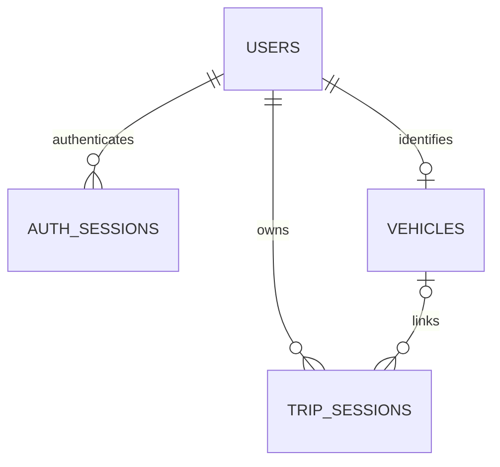

# VIN 기반 차량 계정 설계

## 계정 기준

RouteMate의 사용자 단위는 현재 차량 계정이다. 실제 차량의 비즈니스 식별키는 정규화된 VIN이다.
VIN을 DB 조인 키로 반복하지 않고 내부 UUID를 사용한다. 동일 VIN을 여러 무관한 계정으로 자동 생성하거나,
이미 연결된 차량의 VIN을 안다는 이유로 새 설치에 기존 토큰을 발급하지 않는다.

`vehicles.user_id`는 UNIQUE, 실제 VIN은 UNIQUE이다. 개발용 Mock은 실제 VIN과 별도 공간으로
`UNIQUE(source, vin)`을 적용한다. 현재 실차 출처는 `PLEOS_SDK` 하나이다.
`trip_sessions(vehicle_id, user_id)` 복합 외래키는 타 계정의 차량 연결을 DB 수준에서도 차단한다.

## 실제 SDK에서 확인한 속성

공식 문서와 Maven의 Vehicle SDK 2.3.2 AAR를 함께 확인했다.

| 저장/응답 값 | 확인된 원천 | 설계 |
| --- | --- | --- |
| `vehicles.vin` | `Vehicle.getCarInfo().getVINInfo`의 `String?` 콜백 | 필수 VIN, 정규화 및 형식 검증. null·미지원·권한 오류는 등록 중단 |
| `vehicles.vin_access_type` | `checkVINInfoCapabilities`의 `CapabilityConfig.accessType` | 실차는 READ/READ_WRITE. NONE/WRITE는 조회 불가로 처리 |
| `vehicles.source` | 앱에서 선택한 PLEOS_SDK/MOCK 제공자 | 조회 경로 메타데이터이며 소유권 증명이 아님 |
| `vehicles.created_at`, `updated_at` | 서버 Clock | 서버 기록 시각. SDK 측 차량 생성·수정 시각으로 표현하지 않음 |
| `vehicleId`, `userId` | 서버 UUID | 내부 식별·관계키. Pleos가 반환한 ID로 표현하지 않음 |
| `maskedVin` | VIN 뒤 4자리로 계산 | 자신의 등록 결과 표시용. 다른 사용자에게 원문 VIN 공개 금지 |

`CarInfo`의 공개 AAR에서 검증한 VIN API는 `getVINInfo`, `checkVINInfoCapabilities`이다.
`getCRNInfo`는 deprecated이므로 사용하지 않는다. `getCapabilityInfo`는 라이브러리 제한 및
`PRIVATE_CAR_INFO` 권한 대상이므로 사용하지 않는다.
제조사·모델명·연식은 이 공개 인터페이스에서 해당 getter를 확인하지 못해 DB에 임의로 채우지 않는다.
VIN으로 제조사·연식을 추정하거나 차량 현재 위치를 내비게이션 최종 목적지로 사용하지 않는다.

## 앱 연결 및 실패 처리

1. 실제 차량은 `Vehicle.initialize()` → capability 확인 → VIN 조회 순서로 처리한다.
2. `pleos.car.permission.CAR_INFO`를 선언한다. SDK 초기화에 연결 완료 콜백이 있다고 가정하지 않는다.
3. 전체 조회는 10초 제한, 중복·취소 후 늦은 콜백 무시, 완료·실패·취소 시 `release()` 호출을 적용한다.
4. VIN 조회가 실패하면 임의 익명 사용자나 Mock VIN으로 대체하지 않는다.
5. 설치 세션 토큰 → VIN 연결 → 서버에서 확정한 차량의 목적지 등록 순서로 호출한다.
6. 토큰은 서버 origin·VIN·출처별로 분리해 암호화 저장한다. 원문 VIN은 화면·자체 로그에서 숨긴다.

`vehicleProvider=pleos|mock`으로 VIN 제공자를 선택한다. 생략하면 목적지 제공자 설정을 따른다.
Mock VIN은 설치별 합성 값이며 실차 확인으로 표시하지 않는다. 서버의 Mock 허용은 기본 false이다.

## 데이터 보존 및 신뢰 경계

Flyway V3는 새 차량 테이블과 nullable 운행 차량 외래키를 추가하며 기존 사용자·토큰·운행을 삭제하지 않는다.
기존 행에는 실제 VIN 근거가 없으므로 임의로 연결하지 않는다. 기존 설치는 업데이트 후 VIN별 자격증명을 새로 사용한다.
유효한 기존 세션으로 명시적으로 VIN을 연결하고 재등록하는 경우 그 계정의 운행에 차량 관계가 반영된다.

SDK의 VIN 문자열·capability는 서버가 검증한 차량 소유권 증명이 아니다. API는 `ownershipVerified: false`를 반환한다.
새 설치가 이미 연결된 VIN에 접근하려면 추가 소유권/접근 확인 흐름이 필요하며 현재는 409로 중단한다.
Pleos Vehicle Data API의 동의된 차량 목록 같은 서버 검증 경로는 별도 OAuth·이용 지역·프로젝트 권한이 필요하다.
실차 소유권 검증·계정 복구·차량 양도·세션 갱신은 후속 인증 작업이다.

## 근거

- [Vehicle SDK 개요](https://document.pleos.ai/docs/pleos-only/connect-sdk-pleos/Vehicle/intro)
- [SDK 가져오기](https://document.pleos.ai/docs/pleos-only/connect-sdk-pleos/Vehicle/project-setup)
- [Vehicle 권한](https://document.pleos.ai/docs/pleos-only/connect-sdk-pleos/Vehicle/vehicle-permission)
- [2.3.2 릴리스 노트](https://document.pleos.ai/docs/pleos-only/release-note/sdk-release-note)
- [Vehicle Data 동의 차량 목록](https://document.pleos.ai/api-reference/vehicle-data-api/getting-started/for-business-users/request-for-data-sharing)
